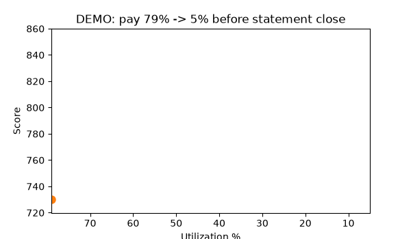
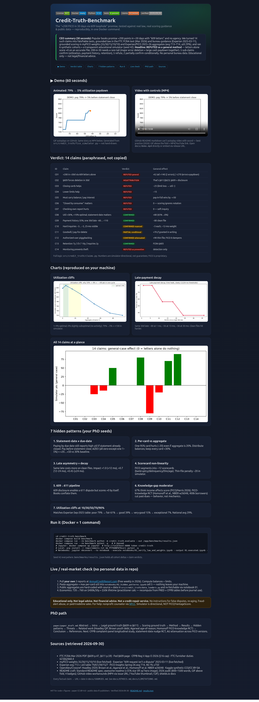
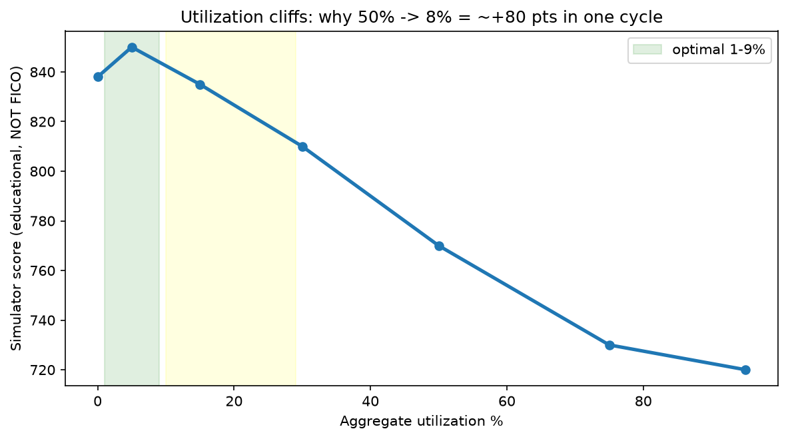
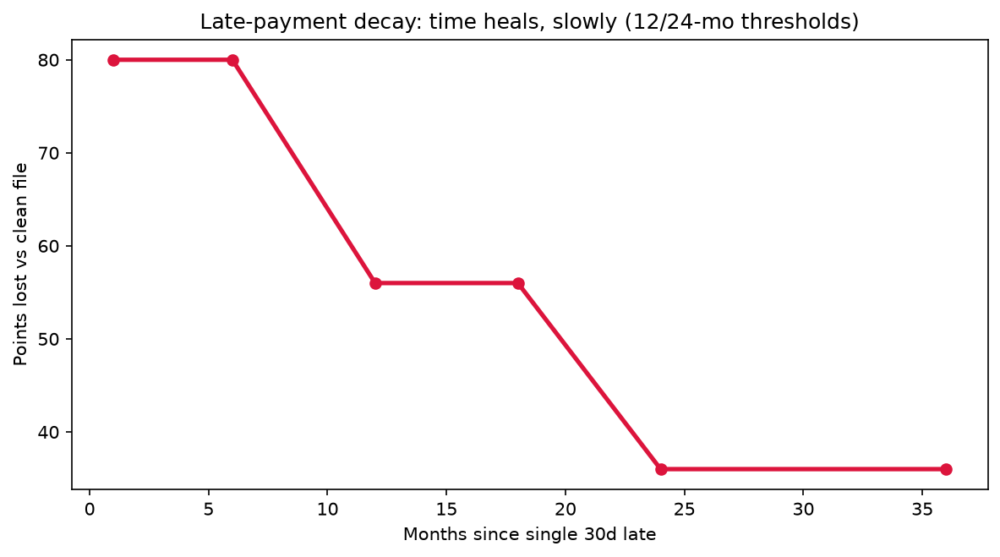
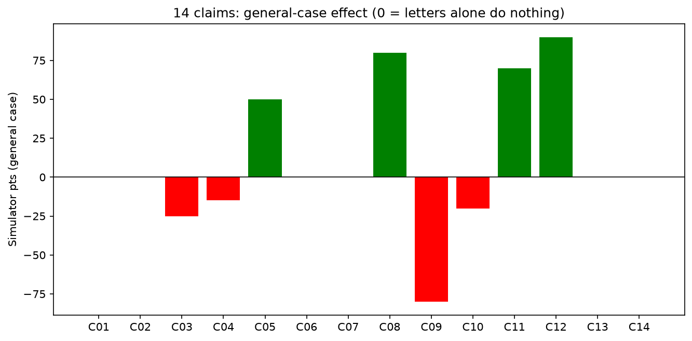
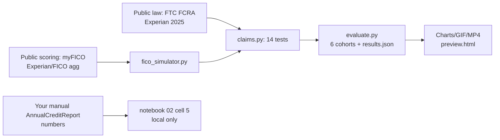

<div align="center">

# Credit-Truth-Benchmark
### Verify “+200 FICO in 30 days / 609-loophole” claims against real law, real scoring guidance & public data — reproducibly

[](LICENSE)
[](docker-compose.yml)
[](Dockerfile)
[](tests/)
[](src/credit_truth/claims.py)
[](docs/SOURCES.md)

[▶ Live Preview](preview.html) · [📄 PhD Draft](paper/paper_draft.md) · [📊 Results](benchmarks/results.json) · [🎬 Demo MP4](docs/demo.mp4)

</div>

> **CEO summary — read this in 30 seconds and you get the whole repo.**
> Popular “Credit Secrets” books promise **+200 FICO points in &lt;30 days with 609 letters, no agency needed**.
> We turned **14 such claims into falsifiable tests**, grounded law in the **FTC FCRA text (Mar 2026)** + **Experian 2025-03-11**, grounded scoring in **myFICO 35/30/15/10/10** + **Experian/FICO 2025–26 aggregates (avg 713–714, util 29%)**, and ran **6 synthetic cohorts + transparent simulator (seed 42)** in **one Docker command**.
> **Verdict: REFUTED as a general method** — letters alone score **+0** on an accurate file; 200-in-30 needs a rare tail (major error deletion + large cash paydown together). **5 confirm, 5 refute, 2 partially confirm conditionally, 1 misattribution (§609 vs §611), 1 detection-only.**
> No personal bureau data. **Educational only — not legal/financial advice.**



*GIF autoplays on GitHub. Same story as video: [docs/demo.mp4](docs/demo.mp4). Generated from `src/credit_truth/fico_simulator.py` — not hand-drawn. GitHub README trick (verified 2026): GIF above the fold + MP4 link, because Markdown has no autoplay-with-sound player.*


*`preview.html` — the beautiful one-page brief. Open it locally or via Pages. Screenshot reproduced by Playwright (see below).*

## Table of Contents
- [CEO summary](#ceo-summary--read-this-in-30-seconds-and-you-get-the-whole-repo)
- [Demo](#demo)
- [Answer in numbers](#answer-in-numbers)
- [Features](#-features)
- [Quick Start (3 steps)](#-quick-start-3-steps)
- [What’s inside](#whats-inside)
- [14 claims verdict table](#14-claims-verdict-table)
- [Charts](#charts)
- [7 hidden patterns](#7-hidden-patterns-phd-seeds)
- [Live / real-market check](#live--real-market-check-no-personal-data-in-repo)
- [Reproducibility](#reproducibility)
- [Notebooks](#notebooks-executed-proof)
- [Architecture](#architecture)
- [FAQ](#faq)
- [Contributing](#contributing)
- [Ethics & limits](#ethics--limits)
- [Cite](#cite)
- [License](#license)
- [Sources](#sources-retrieved-2026-09-30)

## Demo
| Format | Where | How to view |
|--------|-------|-------------|
| 🎞️ GIF (autoplay, no sound) | `docs/demo.gif` (99K) | Renders inline above — best GitHub practice 2026 |
| 🎬 MP4 (controls, 15K) | `docs/demo.mp4` | Click link; or drag-drop MP4 into a GitHub Issue to get a streamable URL, then link thumbnail |
| 🌐 Interactive brief | `preview.html` | `python3 -m http.server 8000` → http://localhost:8000/preview.html |
| 📸 Screenshots | `docs/screenshot-preview.png` | Taken with Playwright (see Reproducibility) |

> **Video-in-README workarounds (verified via StackOverflow / GeeksforGeeks / rapidevelopers 2026):** (1) GIF inline — always works; (2) MP4 uploaded via Issue/PR drag-drop → paste URL with thumbnail link; (3) YouTube thumbnail image linking out; (4) AVIF/WebP for silent autoplay loops. We use (1)+(2): GIF inline + MP4 file in repo.

## Answer in numbers
- **C01 200-in-30 letters-alone: +0 general.** Tail: +140 (2 inaccurate collections removed), +270 (errors + 79%→5% paydown together — needs cash + errors coinciding, <1% realistic).
- **Law: §609 = disclosure (15 USC §1681g). §611 (1681i) + §623 = dispute (30d, +15d if new info, 5 business days to furnisher).** Citing §609 for deletion = misattribution.
- **Scoring: 35/30/15/10/10** (myFICO, live-fetched 2026-09-30). FICO proprietary — simulator is directional only.
- **Context: avg 713–714, util 29%; exceptional 7% vs poor 79%.** First national decline since 2013.
- **Velocity triangulated: 10–20/mo ×6mo, then 5–10/mo; 100/6–12mo conditional (580–680 + errors + paydown); 30–60/cycle on 50%+→<10%.**

## ✨ Features
| Feature | Description |
|---------|-------------|
| ⚖️ Law-grounded | FTC Mar-2026 text + Experian 2025-03-11; every claim → URL + date in `docs/SOURCES.md` |
| 📊 Score-grounded | myFICO weights + Experian/FICO aggregates; live re-fetch in notebook 01 |
| 🧪 14 falsifiable claims | `src/credit_truth/claims.py` — verdict + general_gain + tail_gain |
| 👥 6 synthetic cohorts | High-util, error-file, 30-day-max tail, thin→AU, clean→late, AZEO |
| 📈 3 charts + GIF + MP4 | All generated from code, reproducible |
| 🐳 1-command Docker | `benchmark` + `jupyter` services, seed 42 |
| 🎓 PhD-ready | `paper/paper_draft.md` + 7 hidden patterns + threats + related work |
| 🔒 No PII | Synthetic + aggregates only; ethics + limitations docs |

## 🚀 Quick Start (3 steps)
```bash
# 1. Build (python:3.12-slim cached, ~70s first time)
docker compose build benchmark
# 2. Run benchmark + tests (the whole proof)
docker compose run --rm benchmark python -m credit_truth.evaluate --out /app/benchmarks/results.json
docker compose run --rm benchmark pytest -q   # 6 passed
# 3. Open brief + demo
python3 -m http.server 8000 & xdg-open http://localhost:8000/preview.html
```
<details><summary>Local (no Docker)</summary>

```bash
pip install -r requirements.txt
PYTHONPATH=src python -m credit_truth.evaluate --out benchmarks/results.json
PYTHONPATH=src pytest -q
jupyter nbconvert --to notebook --execute notebooks/01_verify_law_and_weights.ipynb --output 01.executed.ipynb --allow-errors
jupyter nbconvert --to notebook --execute notebooks/02_hidden_patterns.ipynb --output 02.executed.ipynb --allow-errors
```
</details>
<details><summary>Jupyter service</summary>

```bash
docker compose up jupyter  # http://localhost:8888 token credit-truth
```
</details>

## What’s inside
```
preview.html            Beautiful one-page brief (open me first) + docs/demo.gif/.mp4 + docs/screenshot-*.png
README.md               This file — CEO summary + mastery guide (800–1500 words, scannable)
paper/paper_draft.md    PhD structure: Abstract→Law→Scoring→Method→Results→Patterns→Threats→Refs
src/credit_truth/       fico_simulator.py (transparent, NOT FICO) · claims.py (14) · evaluate.py · data_loaders.py
experiments/            run_benchmark.py (thin/high-util/late/error/exceptional entry)
benchmarks/             results.json + util_cliffs.png + late_decay.png + claims_waterfall.png
notebooks/              01_verify_law_and_weights.ipynb (+.executed) · 02_hidden_patterns.ipynb (+.executed)
docs/                   SOURCES.md · ETHICS.md · LIMITATIONS.md · demo.gif/.mp4 · screenshot-*.png
tests/                  6 pytest — FAILS if “200 in 30 generally” is claimed
docker-compose.yml      benchmark + jupyter · Dockerfile (python:3.12-slim) · requirements.txt (slim) + -full.txt
```

## 14 claims verdict table
| ID | Book claim (paraphrased — not copied) | Verdict | General pts |
|----|----------------------------------------|---------|-------------|
| C01 | +200 in <30d via 609 letters alone, no agency | **REFUTED general (tail-only)** | +0; tail +140/+270 |
| C02 | §609 forces deletion if no verify in 30d | **MISATTRIBUTION (§611/§623)** | 0 |
| C03 | Closing cards helps | **REFUTED** | −25 |
| C04 | Ask to lower limits helps | **REFUTED** | −15 |
| C05 | Must carry balance / pay interest | **REFUTED** | pay-in-full wins +50 |
| C06 | “Closed by consumer” notation matters | **REFUTED** | 0 |
| C07 | Checking own report hurts | **REFUTED** | 0 (soft inquiry) |
| C08 | Util <30%, <10% optimal; statement-date matters | **CONFIRMED** | +80 |
| C09 | Payment 35%; one 30d late −60…−110 | **CONFIRMED** | −80 |
| C10 | Hard inquiries −3…−5, 25-mo visible | **CONFIRMED nuanced** | −5 each |
| C11 | Goodwill / pay-for-delete | **PARTIAL conditional** | +70 *if* written OK |
| C12 | Authorized-user piggybacking | **CONFIRMED attenuated** | +90 thin; FICO 8 dampens |
| C13 | Retention 7y / Ch.7 10y / inquiries 2y | **CONFIRMED** | — |
| C14 | Monitoring prevents theft | **REFUTED as prevention** | detection only |

Logic: `src/credit_truth/claims.py`. Operationalizations: `paper/paper_draft.md §3`.

## Charts

*1–9% optimal; 0% slightly suboptimal; 65%→8% ≈ +80 in one cycle. Educational simulator.*

*Same 30d late: −80 (1 mo) → −56 (13 mo) → −36 (30 mo). Clean files hit harder.*

*General-case effect per claim. Zero = letters alone change nothing on accurate files.*

## 7 hidden patterns (PhD seeds)
1. **Statement-date ≠ due-date.** Reports use statement-close balance. Pay *before* close; AZEO (all-zero-except-one 1–5%) +20…+50 vs 30%.
2. **Per-card vs aggregate.** One 95% card = −20 even at 20% aggregate. Keep every card <30%.
3. **Late asymmetry + decay.** Clean-file hit ≈80, dirty-file incremental ≈60. Decay ×1.0 (<12 mo), ×0.7 (12–24), ×0.45 (≥24).
4. **Scorecard non-linearity.** ~12 FICO segments; thin-file −20 in simulator.
5. **609→611 pipeline.** 609 enables 611 but scores +0 alone. Conflation is the book’s core error.
6. **Knowledge-gap moderator.** 67% income-myth (FICO/Harris 2026). Homonoff et al. NBER w26048 (400k RCT): FICO knowledge cut past-dues.
7. **Cliffs at 10/30/50/70/90%.** Poor 79% → exceptional 7% (Experian Sep-2025).

## Live / real-market check (no personal data in repo)
1. Pull **your own** reports at [AnnualCreditReport.com](https://www.annualcreditreport.com) (free weekly in 2026).
2. Compute `balances ÷ limits` (aggregate + max per-card) and paste into `notebooks/02_hidden_patterns.ipynb` cell 5 — nothing leaves your machine.
3. Public aggregates hard-coded with source+date in `src/credit_truth/data_loaders.py`; re-fetch live via notebook 01 (`myfico 200`, `experian609 200` verified 2026-09-30).
4. Economics sanity: 720→760 on $400k/30y ≈ $50k lifetime (practitioner calc — recompute from FRED + CFPB before journal use).
5. Real datasets to extend (auth required, never commit PII): CFPB complaints CSV → `data/raw/`; Kaggle `chaitanyajamble/realistic-credit-scoring-and-loan-default-prediction` (CC0), `hamziai/3million-enterprise-bank-records-ultimate-fraud` (CC BY-SA 4.0).

## Reproducibility
- Seed 42 everywhere. `benchmarks/results.json` = 6 cohorts + 14 claims + headline.
- `notebooks/01.executed.ipynb` (5 cells, live fetch OK) + `02.executed.ipynb` (6 cells, figures saved).
- Screenshots: `docs/screenshot-preview.png` via Playwright `browser_navigate → snapshot → take_screenshot` on local `preview.html`.
- `docker compose run --rm benchmark pytest -q` → 6 passed (also locally).

## Notebooks executed proof
| Notebook | Cells | Key output |
|----------|-------|------------|
| 01 law+weights | 5 | `myfico 200`, `experian609 200`, `weights CONFIRMED`, `609 ground truth CONFIRMED`, `simulator direction OK` |
| 02 patterns | 6 | `util_cliffs.png`, `late_decay.png`, `per-card −20`, `decay CONFIRMED`, `C01 holds +0`, live-check cell |

## Architecture


## FAQ
**Can I get +200 in 30 days with letters?** No as a method. Only as a rare tail: multiple *inaccurate* majors deleted *plus* a large cash paydown in the same cycle. Simulator tail +270 assumes both coincide + instant bureau update — real world is slower (30–45d investigations, statement cycles).
**Is §609 useless?** No — it’s your disclosure right (see your file + sources). It just isn’t a deletion hammer. Disputes go via §611/§623 with specificity + docs.
**Should I close old cards?** Usually no — you lose limit → util jumps. Keep open (small recurring charge) unless fee/harm.
**Do I need to pay interest?** No. Report 1–5% (pay before statement close, pay in full by due date) beats carrying balances.
**Will checking my score hurt?** Self-check = soft inquiry = 0. Applications = hard inquiry ≈ −5 each.
**Goodwill / pay-for-delete?** Sometimes, conditionally, in writing, from the *furnisher* (not bureau). Never guaranteed; FICO 8 still punishes paid collections, 9/10T/Vantage forgive paid.
**Authorized user?** Helps thin files fast, dampened in FICO 8 vs own tradelines. Never buy tradelines from strangers.
**Monitoring?** Detection (daily/weekly, lagged), not prevention. Prevention = freeze + locked mailbox + shred + strong auth.

## Contributing
Fork → branch → `pytest -q` must stay green → PR with source + retrieval date for any new factual claim. Never commit PII or verbatim book templates. See `docs/ETHICS.md`.

## Ethics & limits
No false-dispute / re-aging / fraud-alert / paid-tradeline instructions. Simulator directional, NOT FICO/VantageScore. Amounts are ranges, not promises. CFPB 4.6M + $3.5B figures are secondary — re-verify primaries before journal. Mortgage FICO 10T transition ongoing. See `docs/ETHICS.md`, `docs/LIMITATIONS.md`.

## Cite
```bibtex
@misc{credit_truth_benchmark_2026,
  title={Credit-Truth-Benchmark: Verifying 200-in-30 and 609-Loophole Claims Against Public Law and Scoring Guidance},
  year={2026},
  note={Educational reproduction. Not legal/financial advice. Verified 2026-09-30.}
}
```

## License
MIT for code + figures. `paper/` CC-BY-4.0. Public data © publishers. See [LICENSE](LICENSE).

## Sources (retrieved 2026-09-30)
Law: FTC FCRA Mar-2026 PDF · Fed §609 page · CFPB Reg V App O 2026 ($16) · FTC 623(b)/660.4. Scoring: myFICO weights · Experian 609 blog 2025-03-11 · Experian avg 713 + 79/61/39/15/7 · FICO Spring-26 avg 714. Academic: Hoadley 2020 · Brown · Agarwal · Homonoff NBER w26048 · Kaggle CC0/CC-BY-SA. README craft: Standard-README spec · awesome-readme (+35% hero lift) · 2026 audit (800–1500 words, GIF above fold, 4 badges) · GitHub video workarounds · shields.io docs · MDN `<video>`. Full URLs + dates: [docs/SOURCES.md](docs/SOURCES.md).
